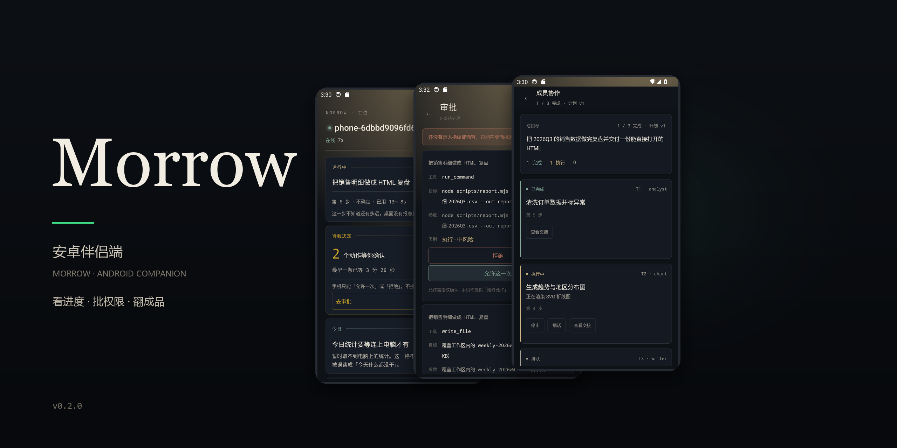
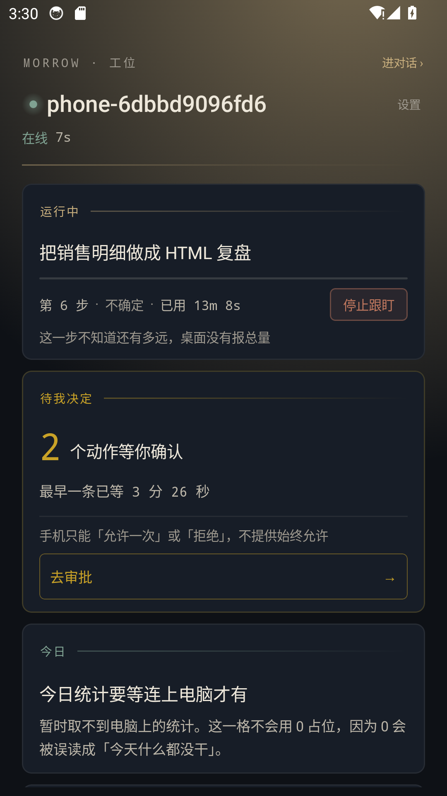
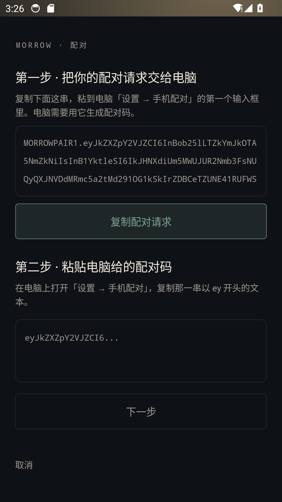

<p align="center">
  
</p>

<h1 align="center">Morrow 安卓端</h1>

<p align="center">Morrow 桌面端的手机伴侣：在手机上盯着任务、批权限、翻成品，工具调用始终在桌面执行。</p>

<p align="center"><a href="README.zh.md">中文</a></p>

<p align="center">
  <a href="https://kotlinlang.org/docs/home.html"></a>
  <a href="https://developer.android.com/jetpack/compose"></a>
  <a href="https://developer.android.com/build/releases/gradle-plugin"></a>
  <a href="https://developer.android.com/studio/releases/platforms"></a>
  <a href="LICENSE"></a>
  <a href="https://github.com/youyuwangzi0001/Morrow-Android/releases"></a>
</p>

<p align="center">
  <a href="docs/README.md">文档地图</a> ·
  <a href="docs/BUILD.md">构建</a> ·
  <a href="docs/PAIRING.md">配对</a> ·
  <a href="CHANGELOG.md">变更记录</a>
</p>

## Overview

Morrow Android is the phone companion of Morrow, a local-first AI workbench for Windows. It renders the desktop
workbench — device state, the running task, pending decisions, today's counters, recent artifacts — and lets you
approve or deny permission requests from the phone. It never executes tools itself: every file write, command, browser
action and window operation still happens on the desktop.

The desktop app lives in [youyuwangzi0001/Morrow](https://github.com/youyuwangzi0001/Morrow). This repository is the
Android source tree and the place where the APK is built and released.

## Features

- **Workbench**: connection state, the running task with step count and elapsed time, pending approvals, today's
  counters, and the four most recent artifacts.
- **Approvals**: each request shows the tool, the target, the parameters and the risk category, with a 120-second
  countdown. Allowing goes through system biometric authentication; the phone never offers "always allow".
- **Conversation and collaboration**: message history with a composer, plus collaboration members with stop, retry and
  new-instruction controls — the latter only appear when the desktop supplied the project, session and task ids.
- **Works**: the desktop work library, pulled on demand with `works.get`, with a product list per work. Images, the
  first page of a PDF, HTML in a restricted WebView and system-decodable video can be previewed, capped at 4 MiB each.
- **Notifications**: four channels (approval, task finished, task stuck, progress) with deep links into the approvals
  page, plus a foreground service that keeps long runs alive.
- **Settings**: theme switch (dark and light), notification permission status, two-step pairing removal, version and
  biometric status.


Captured on an emulator running the release APK against a desktop relay from the Morrow repository; the session names
are test fixtures, not a real user's work.

## Installation

The APK is a sideload build, not a store listing.

| Item | Value |
|---|---|
| Package | `studio.morrow.android` |
| Version | `0.2.0` (versionCode 2) |
| Minimum Android | 8.0 (API 26), target 35, compile 36 |
| Size | about 2.3 MB, release-signed |

1. Download `Morrow-Android-0.2.0.apk` from [Releases](https://github.com/youyuwangzi0001/Morrow-Android/releases) and
   check it against `SHA256SUMS.txt`.
2. Allow "install unknown apps" for the app you use to open the file.
3. On Android 13 and above, grant the notification permission when the app asks; without it approvals and completion
   alerts are suppressed, though the app stays usable.

On a computer with `adb` you can install the same file with `adb install -r Morrow-Android-0.2.0.apk`.

## Usage

1. In the desktop app open **Settings → Phone pairing** and turn the remote channel on.
2. On the phone open the pairing screen, copy the `MORROWPAIR1.` request and paste it into the desktop panel.
3. Paste the ticket the desktop generates back into the phone, then type the six-digit code shown on the desktop. The
   ticket is valid for 90 seconds and can be used once.
4. The workbench switches to online and the running task appears. Approvals arrive as they are raised.

Pairing, the LAN channel and the frame format are described in [docs/PAIRING.md](docs/PAIRING.md).


The pairing screen generates its key pair when the app starts, so the request text changes on every launch.

## Building from source

You need JDK 17 and an Android SDK with platform 36 and build-tools 35.0.0. This project has no Gradle wrapper; it is
built with Gradle 8.14.3.

```bash
gradle :app:assembleDebug      # 调试包
gradle :app:assembleRelease    # 交付包，需要 keystore/keystore.properties
bash scripts/verify.sh         # 构建 + 清单/签名 + 静态断言 + JVM 测试证据
```

`docs/BUILD.md` records the toolchain, the signing setup and why the repository path must stay ASCII for some tools.

## Project structure

```text
app/src/main/java/studio/morrow/android/   14 个生产文件，一个域一到两个文件
app/src/test/java/studio/morrow/android/   28 个测试文件，919 项 JVM 用例
docs/                                       正文、截图、示意图与证据
scripts/                                    构建辅助、向量生成与验收脚本
keystore/                                   交付签名（自签名，见 SECURITY.md）
deliver/                                    已签名的分发 APK 与校验和
```

## Releases

Packages and checksums are published under
[Releases](https://github.com/youyuwangzi0001/Morrow-Android/releases); per-version notes are in
[CHANGELOG.md](CHANGELOG.md). The desktop app keeps its own release line in the Morrow repository.

## Security

- Credentials are stored in a file encrypted by the Android Keystore: device key, session key, desktop address and
  certificate fingerprint are never written in plain text.
- The connection trusts only the certificate fingerprint recorded during pairing, and every frame is sealed with
  AES-256-GCM using a per-direction counter as authenticated data.
- The app requests network, foreground service, notification and biometric permissions. It does not request camera,
  microphone, location or contacts.
- Approvals send back "allow once" or "deny with a reason" — never the raw parameters.

See [SECURITY.md](SECURITY.md) for reporting a vulnerability.

## Known limitations

- There is no verified run on physical hardware in this repository. Evidence comes from JVM and Robolectric tests plus
  a static acceptance script; notification delivery, the biometric prompt and background keep-alive are unverified on
  real devices.
- No Firebase Cloud Messaging: if the system kills the process, no push arrives and the app catches up when it returns
  to the foreground.
- The channel works on the same LAN only. The public relay is a placeholder and has never carried phone traffic.
- Product preview is capped at 4 MiB per file; larger files ask you to open them on the desktop.
- Works, editing, stage changes and export are desktop-only.

## License

MIT, see [LICENSE](LICENSE).
