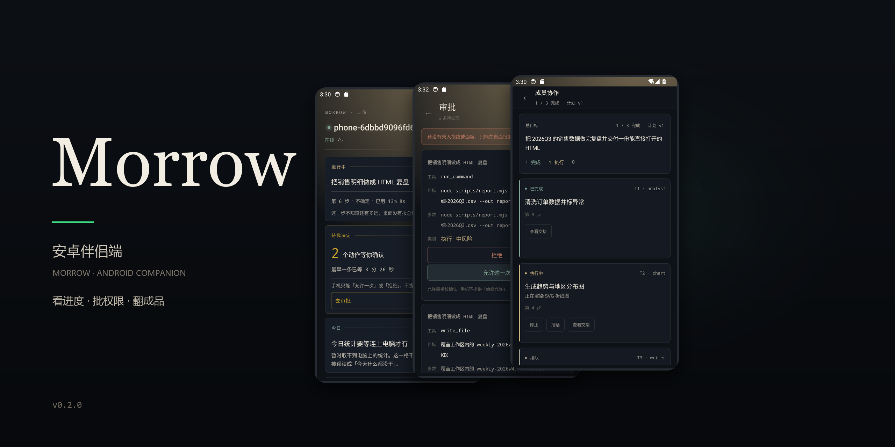
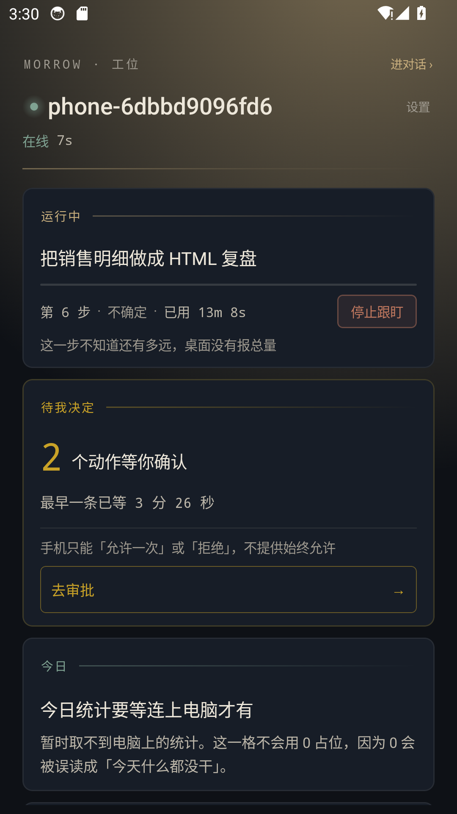
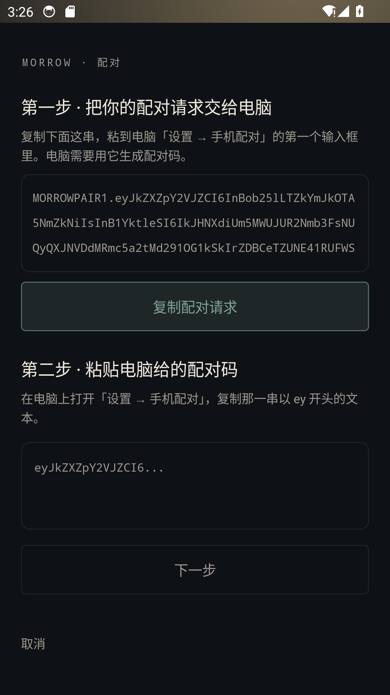

<p align="center">
  
</p>

<h1 align="center">Morrow 安卓端</h1>

<p align="center">Morrow 桌面端的手机伴侣：在手机上盯着任务、批权限、翻成品，工具调用始终在桌面执行。</p>

<p align="center"><a href="README.md">English</a></p>

<p align="center">
  <a href="https://kotlinlang.org/docs/home.html"></a>
  <a href="https://developer.android.com/jetpack/compose"></a>
  <a href="https://developer.android.com/build/releases/gradle-plugin"></a>
  <a href="https://developer.android.com/studio/releases/platforms"></a>
  <a href="LICENSE"></a>
  <a href="https://github.com/youyuwangzi0001/Morrow-Android/releases"></a>
</p>

<p align="center">
  <a href="docs/README.md">文档地图</a> ·
  <a href="docs/BUILD.md">构建</a> ·
  <a href="docs/PAIRING.md">配对</a> ·
  <a href="CHANGELOG.md">变更记录</a>
</p>

## 简介

Morrow 安卓端是 [Morrow 桌面端](https://github.com/youyuwangzi0001/Morrow) 的手机伴侣。它把桌面上的工位状态、运行中的任务、待审批请求、今日统计和最近成品搬到手机上，让你不必守在电脑前就能做决定。它自己不执行任何工具：所有文件读写、命令、浏览器与窗口操作仍然发生在桌面。

桌面端在另一个仓库里独立发版；这里是安卓端的源码、构建与分发的唯一位置。

## 能做什么

- **工位**：连接状态、运行中的任务（步数与已用时长）、待你决定的审批数量、今日统计，以及最近四件成品。
- **权限审批**：每条请求给出工具、目标、参数与风险类别，并带 120 秒倒计时。点「允许」会先过系统生物识别；手机不提供「始终允许」。
- **对话与协作**：消息历史加输入框；协作成员可以停止、重试、发新指令——只有桌面同时给出项目、会话与成员任务 id 时才出现。
- **作品**：按需用 `works.get` 拉取桌面作品库，展示每件作品的成品清单。图片、PDF 首页、受限 WebView 中的 HTML 与系统可解码的视频可以预览，单件上限 4 MiB。
- **通知**：四个渠道（审批、任务完成、任务卡住、长任务进度），审批通知带深链直达对应条目；长任务由前台服务保活。
- **设置**：主题切换（深色 / 浅色）、通知权限状态、两步清除配对、版本与生物识别状态。


在模拟器上安装 release 包、连上桌面仓库真实中继后截取；任务与会话名是测试用的样例数据，不是真实用户作品。

## 安装

APK 是侧载包，不在应用商店。

| 项目 | 值 |
|---|---|
| 包名 | `studio.morrow.android` |
| 版本 | `0.2.0`（versionCode 2） |
| 最低系统 | Android 8.0（API 26），target 35，compile 36 |
| 体积 | 约 2.3 MB，release 签名 |

1. 从 [Releases](https://github.com/youyuwangzi0001/Morrow-Android/releases) 下载 `Morrow-Android-0.2.0.apk`，对照 `SHA256SUMS.txt` 校验。
2. 打开「安装未知应用」权限，允许你用来打开文件的那个应用安装。
3. Android 13 及以上会请求通知权限；拒绝也能用，但审批与完成提醒不会出现。

电脑上装了 `adb` 的话，也可以直接 `adb install -r Morrow-Android-0.2.0.apk` 安装同一个文件。

## 上手

1. 桌面端打开「设置 → 手机配对」，启用远程通道。
2. 手机进入配对页，复制 `MORROWPAIR1.` 开头的配对请求，粘到桌面面板。
3. 把桌面生成的票据粘回手机，再输入桌面显示的六位码。票据 90 秒内有效，且只能用一次。
4. 工位页转为在线，运行中的任务随即出现；审批产生时会自动到达。

配对、局域网通道与帧格式见 [docs/PAIRING.md](docs/PAIRING.md)。


配对请求里的密钥对在应用启动时生成，所以每次启动这段文本都不一样。

## 从源码构建

需要 JDK 17，以及带 platform 36、build-tools 35.0.0 的 Android SDK。本仓库不带 Gradle wrapper，用 Gradle 8.14.3 构建。

```bash
gradle :app:assembleDebug      # 调试包
gradle :app:assembleRelease    # 交付包，需要 keystore/keystore.properties
bash scripts/verify.sh         # 构建 + 清单/签名 + 静态断言 + JVM 测试证据
```

工具链、签名材料与「为什么路径必须是纯 ASCII」记在 [docs/BUILD.md](docs/BUILD.md)。

## 项目结构

```text
app/src/main/java/studio/morrow/android/   14 个生产文件，一个域一到两个文件
app/src/test/java/studio/morrow/android/   28 个测试文件，919 项 JVM 用例
docs/                                       正文、截图、示意图与证据
scripts/                                    构建辅助、向量生成与验收脚本
keystore/                                   交付签名（自签名，见 SECURITY.md）
deliver/                                    已签名的分发 APK 与校验和
```

## 发布

安装包与校验和发布在 [Releases](https://github.com/youyuwangzi0001/Morrow-Android/releases)；逐版本说明见 [CHANGELOG.md](CHANGELOG.md)。桌面端在 Morrow 仓库里走自己那条发版线。

## 安全

- 配对凭据存在由 Android Keystore 加密的文件里：设备私钥、会话密钥、桌面地址与证书指纹都不以明文落盘。
- 连接只信任配对时记下的证书指纹，每一帧用 AES-256-GCM 密封，计数作为认证数据，重复计数被拒绝。
- 应用申请网络、前台服务、通知与生物识别权限，不申请相机、麦克风、定位与通讯录。
- 审批只回传「允许一次」或「拒绝 + 原因」，不携带原始参数。

漏洞报告方式见 [SECURITY.md](SECURITY.md)。

## 已知限制

- 本仓库没有真机运行证据。证据来自 JVM 与 Robolectric 用例加一份静态验收脚本；通知投递、生物识别弹窗与后台保活未在实体设备上验证。
- 未接 Firebase 云消息：进程被系统杀掉后收不到推送，回到前台时补拉。
- 通道只在同一局域网内可用；公网中继是占位实现，从未承载手机流量。
- 成品预览单件上限 4 MiB，更大的文件会提示去桌面打开。
- 作品的编辑、阶段变更与导出只能在桌面做。

## 许可证

MIT，见 [LICENSE](LICENSE)。
