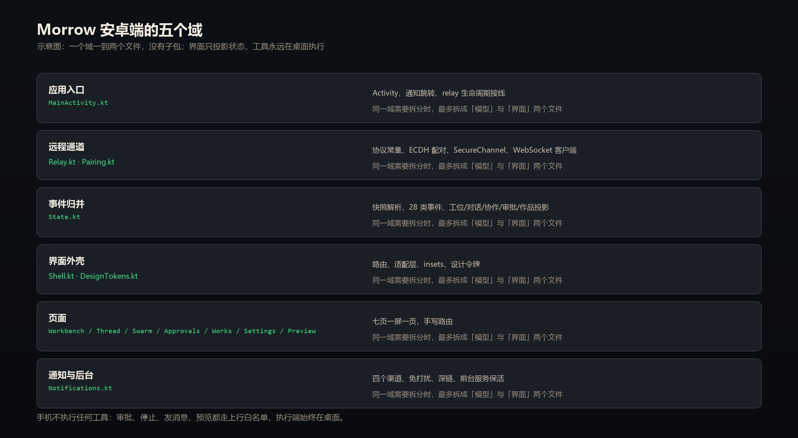

# 源码结构与状态流

这一篇写给要改代码或评估风险的人：源码怎么分域、事件怎么进来、状态怎么投影到页面。

## 五个域

生产代码 17 个文件，全在 `app/src/main/java/studio/morrow/android/` 一个包里，没有子包。

| 域 | 文件 | 职责 |
|---|---|---|
| 应用入口 | `MainActivity.kt` | Activity、通知跳转、relay 生命周期接线、`MorrowApplication` |
| 远程通道 | `Relay.kt`、`Pairing.kt` | 协议常量、帧编解码、SecureChannel、WebSocket 客户端、配对状态机 |
| 事件归并 | `State.kt`、`MessageCodec.kt` | 快照解析、28 类事件、按域投影；消息与结构化块的编解码 |
| 富文本 | `RichText.kt` | Markdown 解析（纯函数）与块级/行内渲染、表格、行级 diff |
| 界面外壳 | `Shell.kt`、`DesignTokens.kt` | 路由、分辨率适配、insets、设计令牌 |
| 页面 | `Workbench.kt`、`Thread.kt`、`Sessions.kt`、`Swarm.kt`、`Approvals.kt`、`Works.kt`、`Settings.kt`、`Preview.kt` | 八页界面 |
| 通知与后台 | `Notifications.kt` | 四个渠道、免打扰、深链、前台服务保活 |

新增代码的落位规则：先判断属于哪个域，写进该域已有文件；只有真正的新域才新建文件。同一域需要拆分时，最多按「模型 / 界面」拆成两个文件。不建 `util/`、`common/`、`components/` 这类按类型分的目录。

示意图：一个域一到两个文件，没有子包；界面只投影状态，工具永远在桌面执行。

## 富文本：从桌面块到手机像素

助手回复里的表格、代码块、diff、链接都不是手机上生成的，而是桌面下发的**结构化块**。这条链路有四段，每段各自可测：

| 段 | 位置 | 输入 | 输出 |
|---|---|---|---|
| 裁剪 | 桌面 `relay-phone.ts` | `ChatMessage.content` | `blocks: PhoneBlock[]` |
| 解码 | `MessageCodec.kt` | wire JSON | `List<UiBlock>` |
| 投影 | `Shell.kt` | `UiMessage` | `ThreadMessage` |
| 渲染 | `RichText.kt`、`Thread.kt` | Markdown 源码 / diff 原文 | 表格、代码卡、红绿行 |

裁剪那一段有一条硬边界：**命令输出与文件内容永不下发，只有文件写入类工具的行级 diff 例外**。理由是前者可能含密钥与私有文件，而后者正是用户判断「它到底改没改我的代码」的唯一依据；桌面侧对 diff 也设了 16 KB 上限，超限整块丢弃而不是截断——截断的补丁会显示一个「改到一半」的假象。

解析器刻意独立于 Compose：`MarkdownParser` 只吃 `String` 吐数据类，因此 25 项解析用例在普通 JVM 里 0.06 秒跑完，不必起 Robolectric 沙盒。渲染层的失败（表格没横滚、diff 没上色）另有一组节点断言，两类失败各自定位。

同一个 JSON 会沿三条路径到达手机——快照 `messages`、`messages_replaced.messages`、`message_completed.message`。三处共用 `UiMessageCodec.fromWire`，否则新增一个字段必然漏掉其中一处，表现为「首连能看到 diff、重连之后就没了」这类只在特定时序出现的缺陷。

## 事件怎么进来

入口只有一条：relay 连接上的加密帧。解密后按外层信封的 `kind` 分派，`event` 交给事件流，`result` 交给上行请求的应答。

事件流做三件事：

1. **解析**：`RelayProtocol` 把 JSON 解析成 `Parsed(seq, sessionId, action)`，28 类事件各有一个 `EventAction`。不认识的类型不丢弃，标成 `Unparsed` 并记录原因——这样新增事件时能一眼看出是没接线还是真未知。
2. **归并**：`EventReducer.apply` 把 action 合并进 `MorrowUiState`。快照是替换，增量是合并；`lastSeq` 只在快照时重置，因为桌面重启后序号会从 1 重来。
3. **投影**：各域的 `*Projection` 从 `MorrowUiState` 算出页面要的数据（工位四区块、对话消息、成员卡、审批队列、作品摘要）。

这三步分开的理由是它们失败的姿势不同：解析错是字段对不上，归并错是状态算错，投影错是页面显示错。混在一起时任何一处出问题都表现为「页面不对」，定位不了。

## 首连与补漏

手机第一次连上时 `lastSeq` 是 0，桌面会先在 `welcome` 里告诉它要不要补快照，然后把快照作为一条 `event` 发下来。快照是一次性的「连接时刻状态」，不进重放缓冲。

重连时如果手机落后太多、桌面缓冲已滚过去，同样回落到快照。所以「断线期间发生了什么」不需要手机自己推理——桌面要么补事件，要么补快照。

## 上行只有白名单

手机能发给桌面的方法只有这些，全部在桌面侧的 `PHONE_METHODS` 里列明，新增一个要同时改两端：

| 方法 | 用途 | 参数 |
|---|---|---|
| `approval.decide` | 审批 | `requestId`、`decision`（`once` / `deny`） |
| `run.stop` | 停止跟盯 | `sessionId` |
| `message.send` | 发指令 | `sessionId`、`text` |
| `swarm.stopMember` / `swarm.retryMember` | 成员干预 | `projectId`、`taskId` |
| `swarm.instruction` | 成员插话 | 上面三项加 `text` |
| `works.get` | 拉作品库摘要 | 无 |
| `works.preview` | 取一件成品 | `workId`、`productId` |
| `snapshot.get` | 主动要一份快照 | 无 |
| `ping` | 保活探测 | 无 |

没有「执行工具」这一项。手机没有能力让桌面跑任意命令，这是设计上的硬边界，不是尚未实现的待办。

## 界面外壳

`Shell.kt` 里有一个手写路由枚举（`Workbench`、`Thread`、`Sessions`、`Swarm`、`Approvals`、`Works`、`Pairing`、`Settings`）和一个 `AdaptiveScaffold`。没有引入 Navigation Compose：八个页面、无参数传递、返回路径固定，导航库带来的「路由字符串 + 参数序列化 + 返回栈」三套概念在这里是净负担。

适配层把屏幕算成档位（宽度类别、是否短屏），页面据此决定列数与留白，页面自己不查 `Configuration`——否则每个页面一套判断，迟早互相矛盾。

insets 只有一条规则：**只吃 padding 不吃 margin**。用 margin 会在容器外侧留白，那圈空白由父级背景填充，状态栏区域就会出现一条不同色的边。手势条区域额外加 8dp，避免底部主操作按钮被上滑手势误触。

## 通知与后台

`Notifications.kt` 建四个渠道（审批、任务完成、任务卡住、长任务进度），并按事件产生提醒：新审批、`run_finished`、成员失败或耗尽、同一轮步数推进。进度类最多每 5 秒一条。

免打扰期间，审批单独提醒，其余合并成一条汇总。渠道创建后重要性由系统设置决定，应用只更新名称与描述，不会每次启动把被关掉的渠道改回高优先级。

长任务由前台服务保活（`foregroundServiceType="dataSync"`）。选 `dataSync` 而不是 `shortService`：后者上限约 3 分钟，长任务会跑几十分钟，必然被砍。Android 15 起 `dataSync` 有累计时长上限，到点由服务自己停止。

没有接 Firebase 云消息。进程被系统彻底杀掉后不会收到推送，回到前台时补拉。

## 安全边界

- 渲染与网络都在同一个进程，没有 WebView 承载主界面；唯一的 WebView 用于预览 HTML，且关闭了本地文件访问、禁止混合内容。
- 凭据文件由 Android Keystore 加密；设备私钥与会话密钥不落明文。
- 清单里没有 `VIEW` intent-filter，`morrow://` 深链只由应用自己的显式 Intent 触发。
- 审批接收器 `exported="false"`，前台服务同样不导出：外部应用无法伪造「拒绝」决策或驱动服务。

