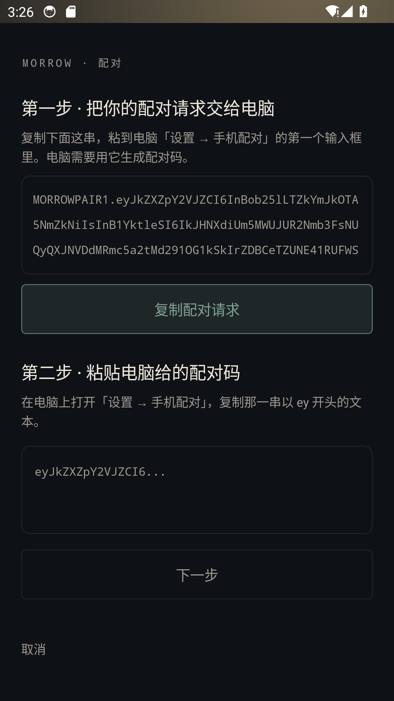
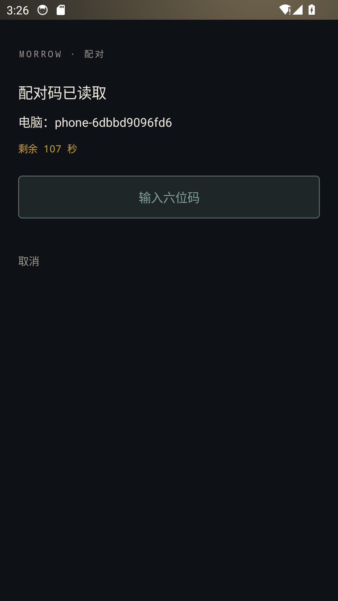
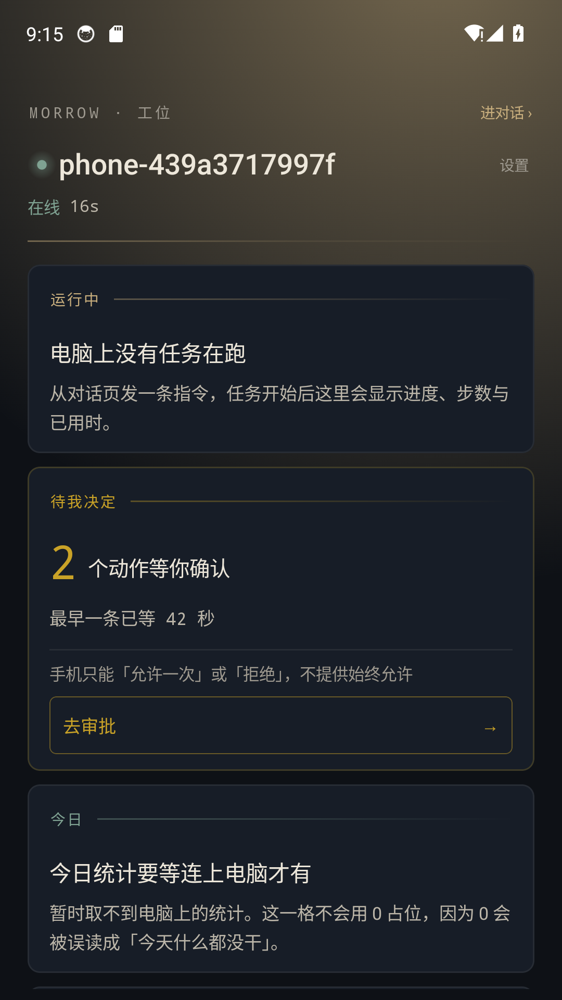

# 装上与第一次配对

这一篇面向第一次用的人：把 APK 装进手机、和桌面连上、看懂工位页的第一屏。配对之外的细节在 [PAIRING.md](PAIRING.md)，页面细节在 [SCREENS.md](SCREENS.md)。

## 装 APK

APK 是侧载包，不在任何应用商店。下载地址与校验和见仓库的 Releases 页。

| 项目 | 值 |
|---|---|
| 文件 | `Morrow-Android-0.2.0.apk` |
| 包名 | `studio.morrow.android` |
| 体积 | 约 2.3 MB |
| 最低系统 | Android 8.0（API 26） |

安装步骤：

1. 把 APK 传到手机，或在电脑上执行 `adb install -r Morrow-Android-0.2.0.apk`。
2. 允许「安装未知应用」；系统会提示来源未知，这是侧载包的正常提示。
3. 首次启动没有登录、没有账号同步，直接落在工位页，连接状态为「未配对」。
4. Android 13 及以上会立刻请求通知权限。拒绝也能用，但审批与完成提醒不会出现。

签名是自签名交付密钥，只保证「同一个包能被覆盖安装」。它不构成正式发行版的安全承诺，也不用于上架。

## 连上桌面之前的工位页

未配对时工位页只有空态，而空态的措辞是刻意写死的：它不会说「没有任务」，只说「还没和电脑配对」。这两句话的区别在于，前者会被误读成「桌面闲着呢」，后者才是真实原因。

| 区块 | 未连接时显示什么 |
|---|---|
| 运行中 | 还没和电脑配对 |
| 待我决定 | 还不知道有没有事等你决定 |
| 今日 | 今日统计要等连上电脑才有 |
| 最近成品 | 还没有成品 |

同理，页脚写的是「尚未同步」而不是「已同步」。应用宁可让你看到「还不知道」，也不显示一个假的零。

## 完成一次配对

1. 桌面端打开 **设置 → 手机配对**，启用远程通道。
2. 手机点工位页「今日」区块右上角的「去配对 ›」，进入配对页第一步。
3. 点「复制配对请求」，把那段 `MORROWPAIR1.` 文本粘到桌面面板的第一个输入框。
4. 桌面签发票据后，把以 `ey` 开头的文本粘回手机第二步。
5. 点「下一步」，输入桌面显示的六位码，点「确认」。

票据 90 秒内有效且只能用一次。六位码最多错 3 次，超过后这张票据作废，要回桌面重新生成。

配对请求里的密钥对在应用启动时生成，所以每次启动这段文本都不一样；用过一次的票据不能再用。

第二步的输入框只接受票据文本；六位码在下一步出现，倒计时从票据签发时开始算。

## 连上之后

配对成功后应用自动回到工位页，连接状态变成「在线」并开始计在线时长。此时：

- 「运行中」显示桌面当前这一轮的任务标题、步数与已用时长；按钮是「停止跟盯」，不是「停止任务」。
- 「待我决定」显示待审批条数与最早一条已等多久，点「去审批」进入审批页。
- 「今日」显示今天跑了几轮、用了多少 token；桌面没给数据时它仍然说「暂时取不到」，不写 0。

在模拟器上安装 release 包、连上桌面仓库真实中继后截取；会话与审批内容是测试样例数据。

## 怎么算成功

- 工位页左上角的状态灯是金色实心，「在线」后面跟着不断增长的时长。
- 杀掉应用再打开，连接会自动恢复，不需要重新配对。
- 桌面发起一次需要审批的操作时，手机在通知栏收到提醒，点开直达审批页。

三条里有任何一条不成立，先看 [TROUBLESHOOTING.md](TROUBLESHOOTING.md) 的「连接」与「通知」两节。

## 两条安全规则

1. 手机上的「允许」只代表「这一次」。手机不提供「始终允许」，那个决定留在桌面。
2. 危险工具在手机上连「允许这一次」都是禁用态。想批准这类操作，回桌面做。

手机不保存模型 Key，也不执行任何工具。它拿到的是桌面投影出来的状态，不是可以代跑的权限。
