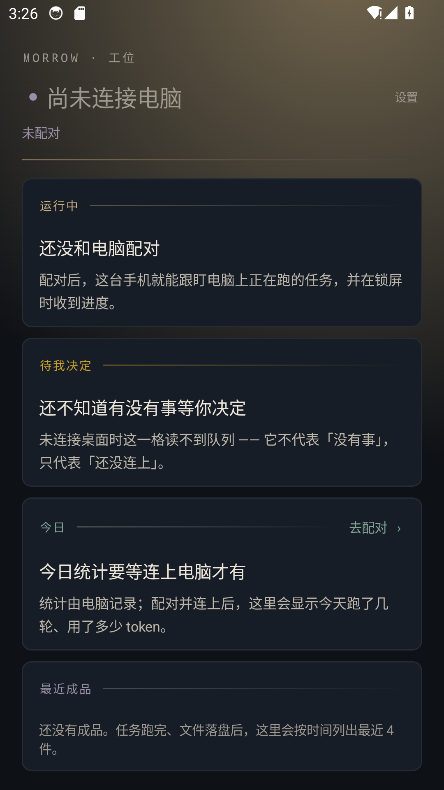
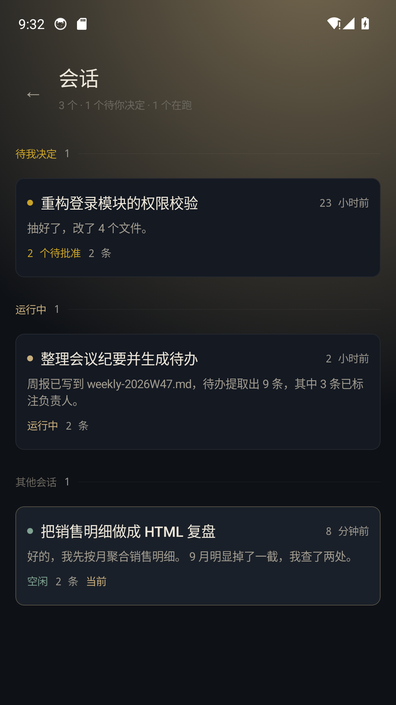
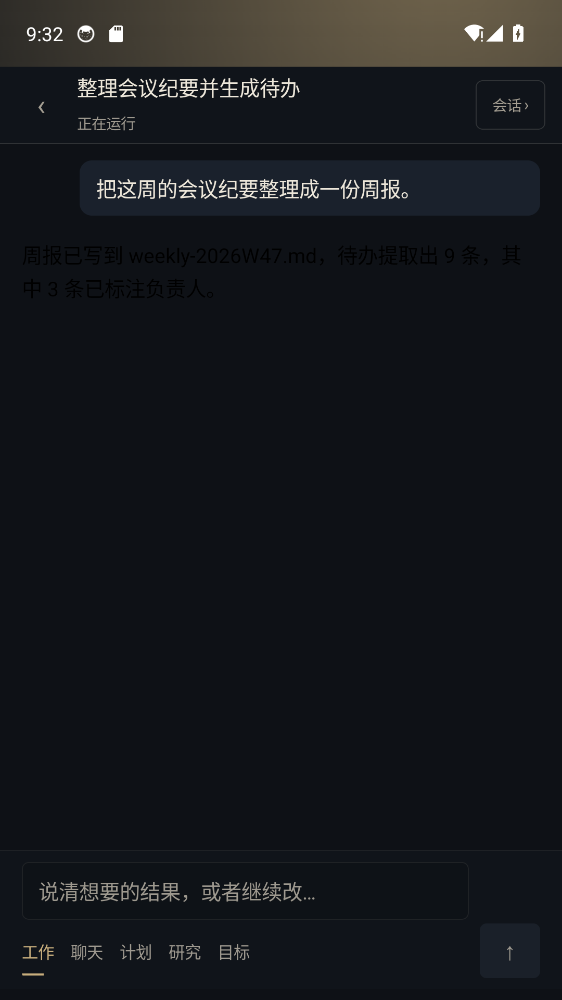
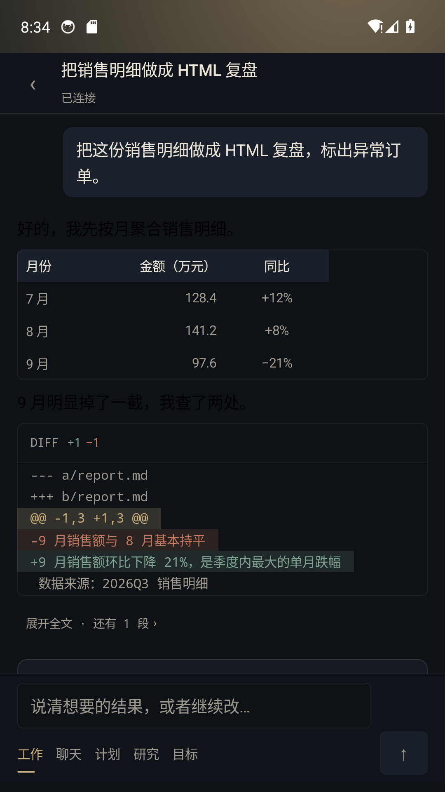
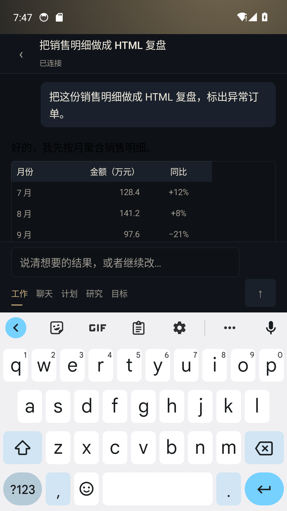
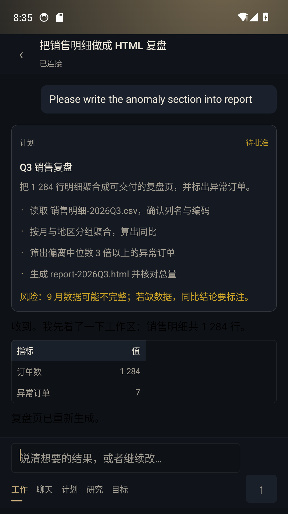
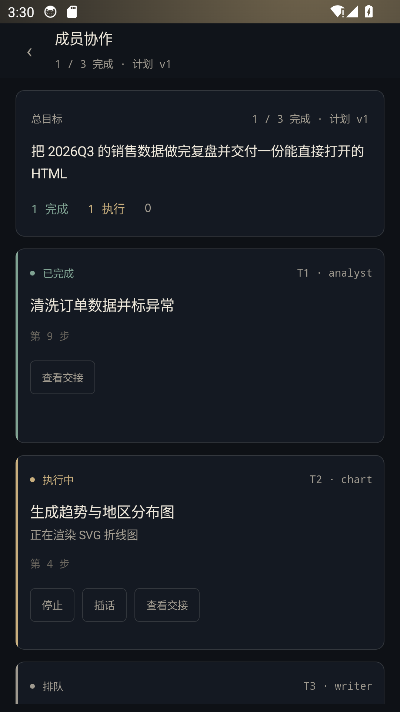
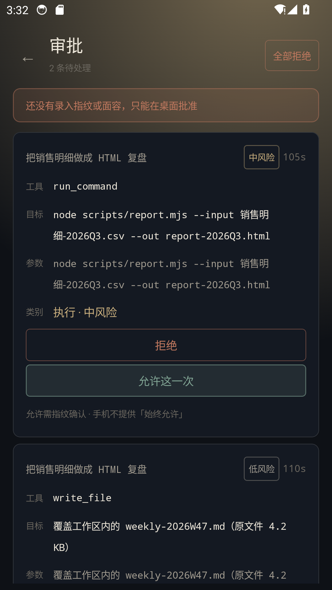
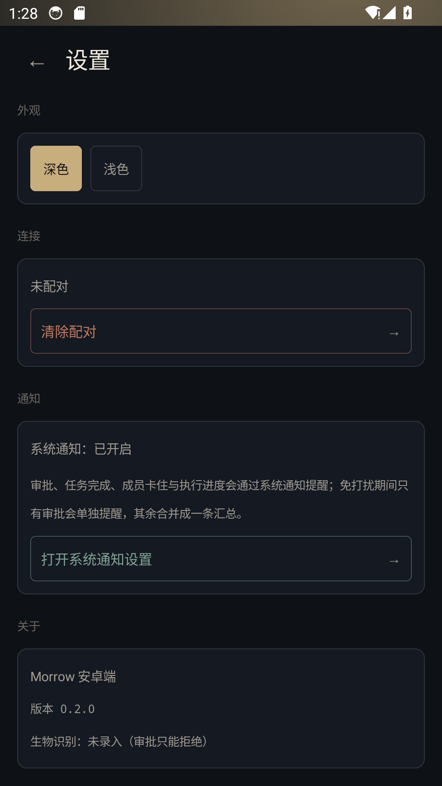
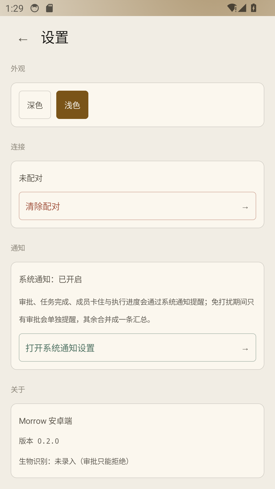

# 八个页面

Morrow 安卓端有八个页面：工位、会话、对话、成员协作、审批、作品、配对、设置。这一篇讲每个页面回答什么问题、数据从哪来、什么情况下会空着。

页面切换是手写的状态机，没有导航库。返回路径固定：会话页与协作页回对话，其余回工位。

## 工位

工位页回答一句话：现在需不需要我起身去开电脑。它由头部连接行和四个区块组成。

连接状态有四个标签，含义不同，页面给的出口也不同：

| 标签 | 含义 | 页面给你的出口 |
|---|---|---|
| 未配对 | 还没和任何电脑配对 | 标题行右侧「去配对 ›」 |
| 正在连接 | 已配对，正在建立连接或重连 | 等待，不引导重新配对 |
| 在线 | 已连上，能收到事件 | 「进对话 ›」，并显示在线时长 |
| 已断开 | 配过但对不上：关机、换网段或通道关闭 | 自动重连，显示上次同步时间 |

「在线」只有一个判定来源：relay 连接状态。前台服务在跑但连接断了，不算在线；反过来，连接在、前台服务没跑，仍然算在线。理由是前台服务只代表本地挂了一条通知，不代表桌面收得到指令。

四个区块：

| 区块 | 回答什么 | 数据来源 |
|---|---|---|
| 运行中 | 桌面此刻在跑什么、跑到第几步、用了多久 | `run_started` / `run_finished` / `tool_progress` |
| 待我决定 | 有没有事等我拍板，最急的等了多久 | `permission_requested` / `permission_resolved` |
| 今日 | 今天跑了几轮、用掉多少 token | `run_started` / `run_finished` / `usage_updated` |
| 最近成品 | 落盘了哪些文件 | `artifacts_updated`，或首连快照 |

没有桌面数据时，工位页停在未配对或已断开，不编造任务、审批与作品。宁可让你看到「还不知道有没有作品」，也不显示一个假的「暂无作品」。

未配对是安装后的第一屏；每一格的措辞都在解释「读不到」，而不是断言「没有」。

## 会话

会话页是手机端「换一个任务看」的唯一入口，从对话页顶栏的「会话 ›」进入（该入口只在有事件流时出现）。

它不是按时间排列的普通列表，而是**按「现在该关注谁」分组**：

| 分组 | 什么会话在这里 | 为什么排前面 |
|---|---|---|
| 待我决定 | 有审批还没处理的会话 | 这是此刻唯一需要用户动手的事 |
| 运行中 | 桌面正在跑的会话 | 进度会变，值得盯着 |
| 其他会话 | 剩下的，按最后活动倒序 | 找历史任务时才看 |

一张卡给出四样东西：状态点（金=运行、琥珀=待审、青=空闲）、标题、相对时间、两行摘要。待审的卡片把**具体条数**写在标签里（「2 个待批准」），比笼统的「待你决定」有用。当前正在看的那个会话带「当前」标记并高亮边框。

摘要会压掉 Markdown 噪声：代码围栏、整张表格、`@@` 行都不进列表——实测只过滤表格分隔行时，摘要里会留下「| 月份 | 金额 | | 7 月 | 128.4 |」，在列表里读不出任何意思。整条消息只有表格时，退回用表格内容拼一句，不留空白。

时间未知（桌面没给 `createdAt`）显示「—」，不写「刚刚」——那是在编一个不知道的事实。同一个空态也分两种说法：未连接说「读不到会话」，已连接才说「桌面上还没有会话」。

三条会话分别落在三个分组里；待审的那张写着「2 个待批准」，当前会话带「当前」标记。

选中一张卡就会切换前台会话并回到对话页。切换后对话页只显示这个会话自己的内容——计划、待办、目标都跟着会话走，不会串到别的任务上。

左侧会话名与「正在运行」都变成了目标会话的，正文只有它自己的两条消息。

## 对话

对话页负责发指令与看回复：标题行（会话标题 + 运行状态 + 成员入口）、消息列表、输入框与五种模式（工作、聊天、计划、研究、目标）。

消息来自事件流：`message_started` 建档，`message_delta` 累积文本与思考，`message_completed` 收尾。重新连上时，桌面会补一份快照，历史消息一次对齐。

助手回复**按 Markdown 渲染**，不是把源码直接铺出来。桌面下发的是一条条结构化块（`text` / `thinking` / `tool` / `error`），手机据此画出：

| 内容 | 手机上看到的 |
|---|---|
| 标题、段落、粗斜体、删除线、行内代码 | 排版后的文字，行内代码带底色与等宽字体 |
| 有序 / 无序 / 任务清单 | 带序号或圆点，任务项的勾选状态用 ✓ / ○ 区分 |
| 围栏代码块 | 等宽卡片、语言标签、横向滚动；超过 24 行折叠成「展开 N 行」 |
| 表格 | 真表格：表头底色、按对齐方式对齐、外层横向滚动（窄屏不压列宽） |
| unified diff | 行级红绿视图（低透明度，不刺眼），`@@` 行单独高亮，超过 20 行折叠 |
| 链接 | 金色下划线，点击交给系统浏览器 |
| 引用、分隔线 | 左侧竖线 / 细分隔线 |

长消息按**块数**折叠：超过 4 块时只铺开前 4 块，末尾给「展开全文 · 还有 N 段」。按块数而不是字数判断，是因为一条 3000 字的表格和一条 3000 字的段落，前者必须折叠。

工具调用折成一个执行组，默认只显示「N 个步骤 · 用时」；展开后每一步一行，带状态标记与「+12 −3 · 新建 · 退出码 0」这类摘要。**改过文件的那一步下面还有一个「查看 diff」**，点开才是行级红绿视图——执行组里可能有十几个文件改动，全部铺开会把「哪几步失败了」淹掉。

思考过程默认收起成一行「思考过程 · N 字」，展开才看原文。它与正文分开，因为混在一起时分不清哪句是结论。

输入框在没有连接时仍然可以打字，但发送会明确失败并保留草稿——把内容吃掉是最差的失败方式。

键盘弹出时输入框会贴在键盘上方（insets 里 IME 与导航栏取较大者，不是相加）；光标可以自由移动，因为输入框保存的是完整 `TextFieldValue`（文本 + 选区），不是每次重组都重建的裸字符串。

表格是真表格（表头底色、金额右对齐、同比居中）；`DIFF +1 −1` 卡片里文件头为灰色、`@@` 为金色、`-` 行锈红、`+` 行青绿；长消息折叠成「展开全文」。

用 uiautomator 量过坐标：键盘收起时输入框在 `[74,1637–1763]`，弹出后移到 `[74,912–1038]`，始终完整可见。

上半是用户消息气泡，中间是桌面下发的计划卡（4 步 + 风险提示），下半是助手回复里的表格。这一轮由手机端 `message.send` 触发，桌面回 `run_started` 后逐步推回。

## 成员协作

协作页显示一次多成员任务的进度：总目标、完成计数、成员卡。每张卡给出标题、角色、状态、步数、备注，以及可用时的三个动作：停止、插话、查看交接。

成员入口只在成员数量大于零时出现，避免点进一个永远为空的页面。

三个动作的可用条件很严格：桌面必须同时给出项目 id、会话 id 与成员任务 id，缺任何一个就整体保持只读，按钮不显示。这样不会出现「点了但发不出去」的假按钮。

「插话」沿用桌面的「重新激活」语义——带新指令重启该成员，不是往正在运行的一轮里注入消息。

已完成、执行中、排队三种状态各占一张卡；按钮的出现与否由桌面是否给全三个 id 决定。

## 权限审批

审批是手机端最重要的页面。一条审批卡必须给出四段信息，缺一段都不该批准。

| 字段 | 回答的问题 |
|---|---|
| 工具 | 它要用哪个工具，属于读、写还是执行 |
| 目标 | 影响哪个文件、目录、窗口或命令 |
| 影响范围 | 这次动作会改动什么，越界到哪里 |
| 类别与风险 | 具体怎么做，一行以内，不是原始 JSON |

按钮只有两个方向：允许这一次、拒绝。危险工具在手机上不提供允许，按钮是禁用态；手机也不提供「始终允许」。

每条审批有 120 秒有效期，界面显示倒计时。过期后不能再允许，只能拒绝。队列按产生时间排序，重复推送的同一条审批会合并。

点「允许」先弹系统生物识别；取消、锁定或验证失败一律按拒绝处理，不会把「没验成」当成「还没决定」。设备没录入指纹或面容时，页面只保留拒绝按钮并写明原因——截图里那条橙色提示就是这个状态。

设备未录入生物识别时，页面顶部会写明「只能在桌面批准」，允许按钮保持禁用。

## 作品

作品页展示桌面作品库：作品名、形态、当前阶段、进度与成品清单。数据不来自事件流，而是打开页面时按需发一次 `works.get`，由桌面回一份摘要。

在线状态决定这一页能说什么。没连上桌面时它不说「没有作品」，而说「读不到作品库」；只有连上并拿到空列表，才显示「电脑上还没有作品」。这个区别很重要，否则一次断网就会让你以为作品被删了。

点成品会走 `works.preview` 向桌面取字节：图片直接解码，PDF 只渲染首页，HTML 在关闭本地文件访问、禁止混合内容的 WebView 里打开，视频按系统解码能力播放。单件上限 4 MiB，超过时明确提示「在桌面打开」。

手机只读作品，不提供编辑、改阶段、重跑任务或导出。

## 配对

配对页分两步：先把本机配对请求交给桌面，再把桌面签发的票据与六位码填回来。票据 90 秒有效、只能用一次，六位码最多错 3 次。完整流程与协议见 [PAIRING.md](PAIRING.md)。

## 设置

设置页有四个分区：

| 分区 | 内容 |
|---|---|
| 外观 | 深色（墨夜）与浅色（素纸）两套主题，切换后立即生效并持久化 |
| 连接 | 当前配对状态与已配对设备，以及两步确认的「清除配对」 |
| 通知 | 系统通知开关状态、四个渠道的说明，以及跳到系统通知设置的入口 |
| 关于 | 版本号与生物识别可用状态 |

深色主题下设置页的样子；浅色主题见下一张。

两套主题共用同一套设计令牌，切换不影响布局与排版。

## 页面进不去时

| 现象 | 原因 | 处理 |
|---|---|---|
| 工位页没有「进对话」 | 未连上桌面 | 先完成配对，或等重连 |
| 对话页没有成员入口 | 桌面没有多成员任务 | 正常，成员数为 0 时入口隐藏 |
| 审批页空 | 没有待审批，或都已过期 | 看工位「待我决定」的数字 |
| 作品页说读不到作品库 | `works.get` 没拿到结果 | 确认在线后重进页面 |
| 协作页按钮都不见了 | 桌面缺项目/会话/任务 id | 正常，缺 id 时保持只读 |

